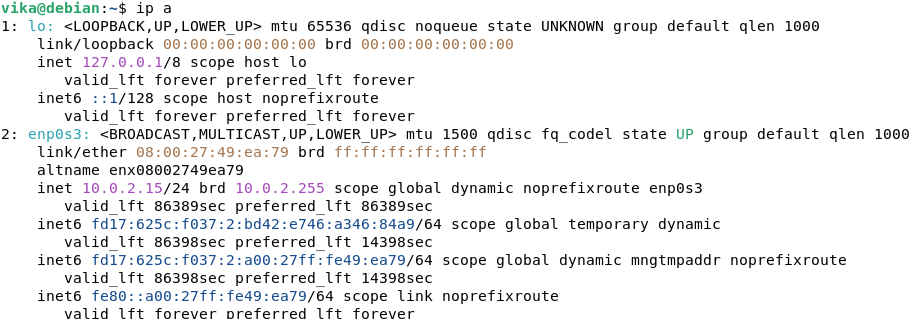
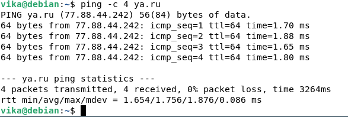
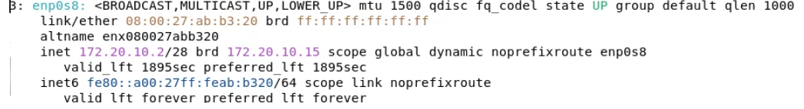
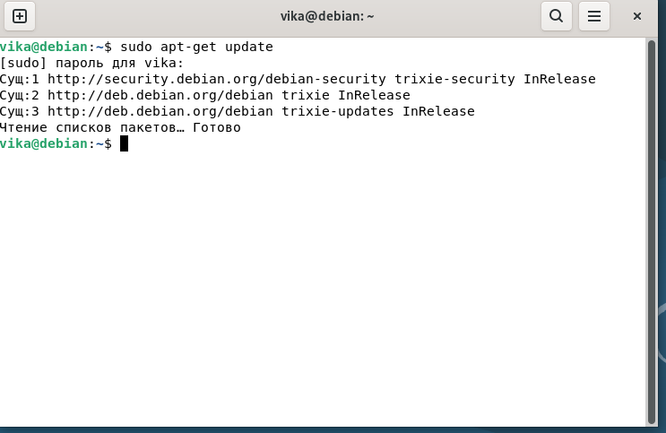
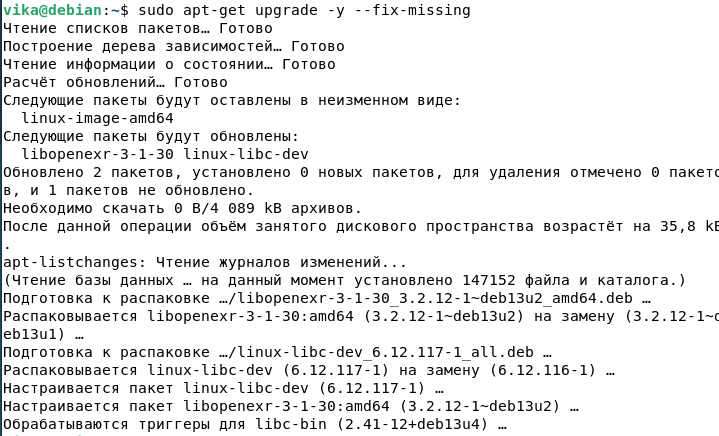
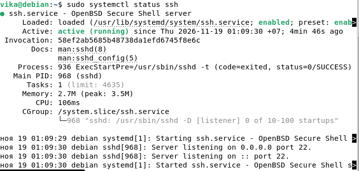
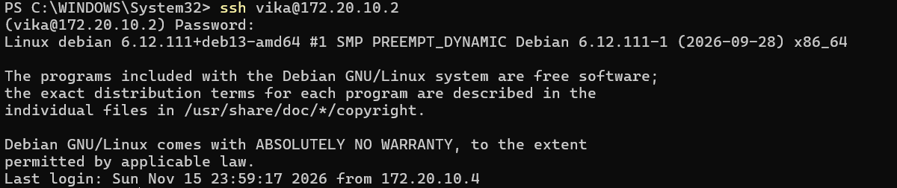
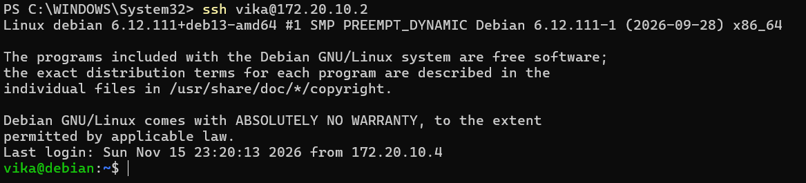

# Лабораторная работа №1: Введение в виртуальные машины и установка Debian

**Выполнила:** Гуркина Виктория  
**Группа:** ИС-25  
**Гостевая ОС:** Debian GNU/Linux 13 (Trixie) x86_64  
**Гипервизор:** Oracle VM VirtualBox

---

### 1. Установка и создание виртуальной машины
В рамках лабораторной работы был установлен и настроен гипервизор Oracle VM VirtualBox.
После запуска VirtualBox была создана новая виртуальная машина с именем `Debian-13`. В качестве типа операционной системы выбран Linux, версия — Debian (64-bit). Для установки использовался ISO-образ операционной системы Debian GNU/Linux 13 (Trixie).

Для виртуальной машины были выделены следующие ресурсы:
*   оперативная память — 4096 МБ (4 ГБ);
*   процессор — 2 вычислительных ядра;
*   виртуальный жесткий диск — 30 ГБ.

### 2. Установка Debian и настройка основных параметров
На созданную виртуальную машину была установлена операционная система Debian GNU/Linux 13 (Trixie).
В процессе установки были настроены основные параметры операционной системы:
*   выбран русский язык интерфейса;
*   настроен часовой пояс;
*   задано имя компьютера (`debian`);
*   создан пользователь `vika`;
*   установлен пароль пользователя и пароль root.

После завершения установки была выполнена загрузка Debian, после чего появился рабочий стол установленной операционной системы (GNOME).

### 3. Настройка сети
Для обеспечения гибкости подключения в VirtualBox были настроены два сетевых адаптера.

#### 3.1. Настройка подключения через NAT (Адаптер 1)
Первый адаптер (`enp0s3`) настроен в режиме **NAT** для выхода виртуальной машины в интернет через основной компьютер.
Для активации интерфейса была выполнена команда:

    sudo nmcli device connect enp0s3

Виртуальная машина получила IP-адрес `10.0.2.15`.

Проверка выхода в интернет:

    ping -c 4 ya.ru

Пакеты успешно доставлены (0% потерь).

#### 3.2. Настройка подключения через Bridged Adapter (Адаптер 2)
Второй адаптер (`enp0s8`) настроен в режиме **Bridged Adapter (Сетевой мост)**. Этот режим позволяет виртуальной машине подключаться непосредственно к локальной сети через физический сетевой адаптер основного компьютера.
Для просмотра IP-адреса использовалась команда:

    ip a

Виртуальная машина получила IP-адрес `172.20.10.2` на интерфейсе `enp0s8`. Данный IP-адрес использовался для подключения к виртуальной машине с основного компьютера по протоколу SSH.

### 4. Обновление системы
После настройки сетевого подключения была выполнена синхронизация списков пакетов Debian и обновление системы:

    sudo apt-get update
    sudo apt-get upgrade -y

Списки пакетов были успешно получены, установленные пакеты приведены в актуальное состояние.

### 5. Настройка SSH-сервера

#### 5.1. Установка SSH-сервера
Для организации удаленного доступа к виртуальной машине был установлен SSH-сервер OpenSSH (в процессе установки системы).
Проверка статуса службы:

    sudo systemctl status ssh

Служба имела состояние `Active: active (running)`.

#### 5.2. Подключение к Debian по SSH с использованием пароля
С основного компьютера под управлением Windows было выполнено подключение к виртуальной машине через Windows PowerShell.

    ssh vika@172.20.10.2

При первом подключении система запросила подтверждение отпечатка ключа SSH-сервера (введено `yes`). После подтверждения был введен пароль. 
Подключение прошло успешно.

#### 5.3. Настройка входа по SSH-ключу (без пароля)
Для безопасного входа без пароля была настроена аутентификация по криптографическим ключам.
На Windows была сгенерирована пара ключей:

    ssh-keygen -t ed25519

Публичный ключ был скопирован на виртуальную машину, после чего были выставлены права доступа:

    chmod 700 ~/.ssh
    chmod 600 ~/.ssh/authorized_keys

Повторное подключение прошло без запроса пароля:

    ssh vika@172.20.10.2

### Вывод
В ходе лабораторной работы была создана и настроена виртуальная машина в среде Oracle VM VirtualBox с установленной ОС Debian 13. Были выделены требуемые ресурсы (4 ГБ RAM, 2 CPU, 30 ГБ HDD). Настроена работа сетевых адаптеров в режимах NAT и Bridged Adapter. Работоспособность сетевого соединения проверена с помощью команды `ping`, после чего система обновлена командами `apt-get update` и `apt-get upgrade`. Для удаленного доступа был установлен и запущен SSH-сервер OpenSSH. Были реализованы и проверены оба способа аутентификации: по паролю и по SSH-ключу. Все поставленные задачи выполнены в полном объеме.
