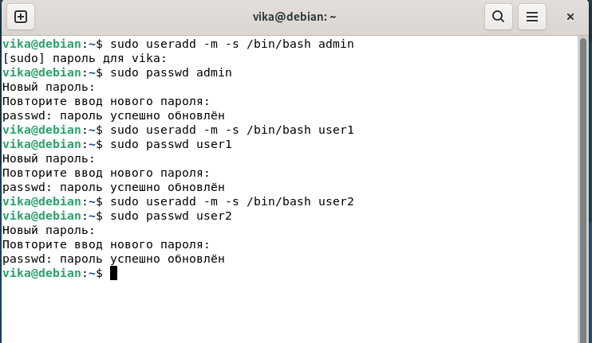
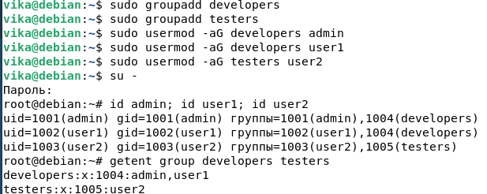
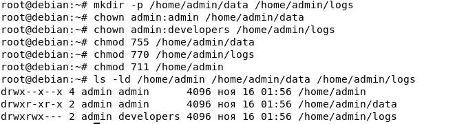
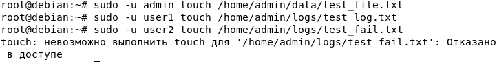
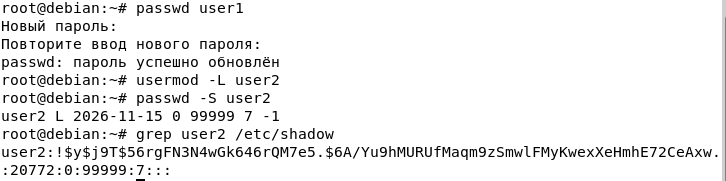
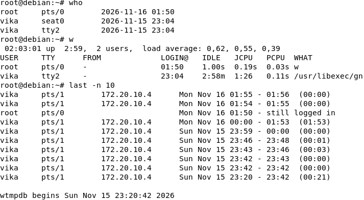
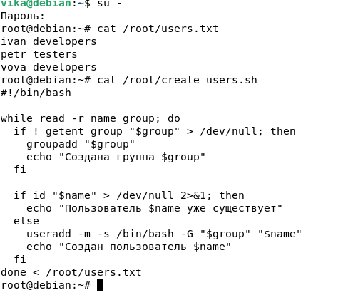
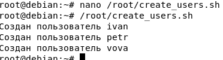
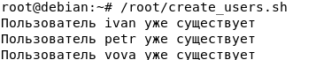

# Лабораторная работа №2: Управление системой и пользователями

**Выполнила:** Гуркина Виктория
**Группа:** ИС-25

**Цель работы:** Научиться создавать пользователей и группы, настраивать права доступа, следить за активностью пользователей и автоматизировать создание пользователей скриптом.

*Все команды выполнялись от имени суперпользователя root.*

## 1. Создание пользователей и групп

Были созданы три новых пользователя: `admin`, `user1` и `user2`. Для создания использовалась команда `useradd` с ключами `-m` (создать домашнюю папку) и `-s /bin/bash` (указать оболочку). Затем для каждого был задан пароль командой `passwd`.

    useradd -m -s /bin/bash admin
    useradd -m -s /bin/bash user1
    useradd -m -s /bin/bash user2
    passwd admin
    passwd user1
    passwd user2

Далее были созданы две группы: `developers` и `testers`. Пользователи `admin` и `user1` добавлены в группу `developers`, а `user2` — в группу `testers`.

    groupadd developers
    groupadd testers
    usermod -aG developers admin
    usermod -aG developers user1
    usermod -aG testers user2

Проверка:

    id admin; id user1; id user2
    getent group developers testers

## 2. Настройка прав доступа

Были созданы каталоги `/home/admin/data` и `/home/admin/logs`. С помощью `chown` владельцем `data` назначен `admin`, а владельцем `logs` — `admin` (с группой `developers`). С помощью `chmod` были настроены права: на `data` — `755`, на `logs` — `770`, на домашнюю папку `/home/admin` — `711`.

    mkdir -p /home/admin/data /home/admin/logs
    chown admin:admin /home/admin/data
    chown admin:developers /home/admin/logs
    chmod 755 /home/admin/data
    chmod 770 /home/admin/logs
    chmod 711 /home/admin
    ls -ld /home/admin /home/admin/data /home/admin/logs

Для проверки были использованы команды `touch` от имени разных пользователей.

    sudo -u admin touch /home/admin/data/test_file.txt
    sudo -u user1 touch /home/admin/logs/test_log.txt
    sudo -u user2 touch /home/admin/logs/test_fail.txt

## 3. Изучение команд для работы с пользователями

Были изучены основные команды:
*   `useradd` — создает пользователя.
*   `usermod` — изменяет параметры пользователя (добавляет в группы, блокирует).
*   `groupadd` — создает группу.
*   `passwd` — меняет пароль.
*   `chown` — меняет владельца файла/папки.
*   `chmod` — меняет права доступа к файлу/папке.

Пароль пользователя `user1` был изменен командой `passwd`. Учетная запись `user2` была заблокирована с помощью `usermod -L`. В файле `/etc/shadow` перед паролем появился символ `!`.

    passwd user1
    usermod -L user2
    passwd -S user2
    grep user2 /etc/shadow

## 4. Мониторинг активности пользователей

Для мониторинга были использованы команды:
*   `who` — показывает, кто сейчас в системе.
*   `w` — показывает, кто в системе и что делает (нагрузка).
*   `last -n 10` — показывает историю последних 10 входов в систему.

    who
    w
    last -n 10

## 5. Автоматизация управления пользователями

Был написан bash-скрипт `create_users.sh`, который читает текстовый файл `users.txt` и создает группы и пользователей. Скрипт проверяет, существует ли уже пользователь или группа, чтобы избежать ошибок.

    nano /root/users.txt
    nano /root/create_users.sh
    chmod +x /root/create_users.sh
    cat /root/users.txt
    cat /root/create_users.sh

Запуск скрипта:

    /root/create_users.sh

Проверка созданных пользователей:

    id ivan; id petr; id vova

Запуск скрипта повторно (проверка на дубликаты):

    /root/create_users.sh

## Вывод

В ходе лабораторной работы были получены навыки создания пользователей и групп в Linux, настройки прав доступа к каталогам, управления паролями и блокировки учетных записей. Были изучены команды мониторинга активности (`who`, `w`, `last`). Также был автоматизирован процесс создания пользователей с помощью bash-скрипта. Все задания выполнены полностью.
