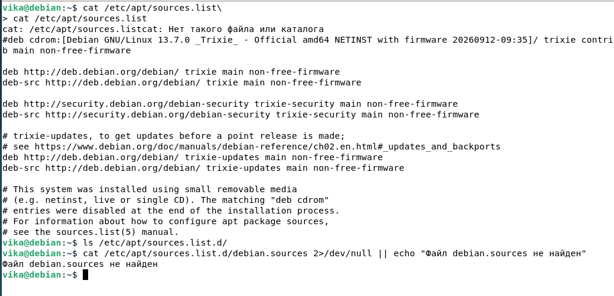
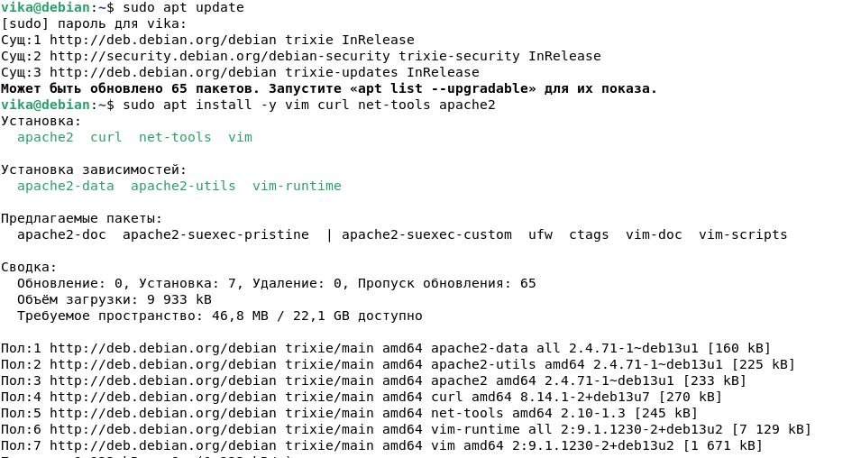
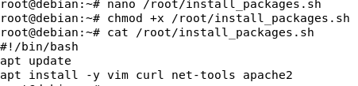
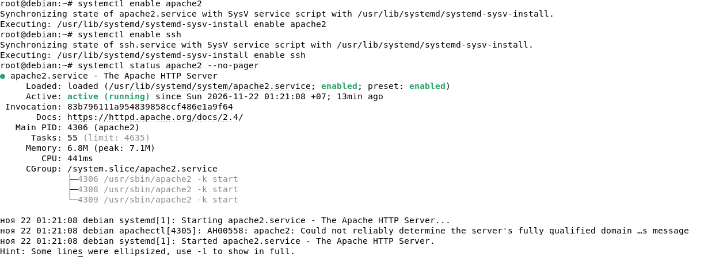
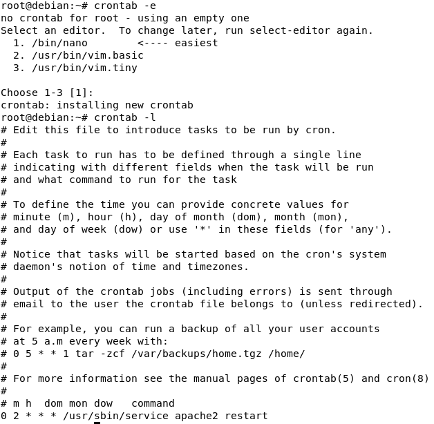
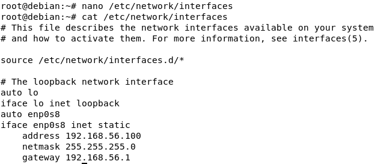
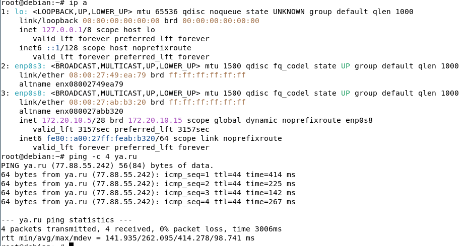
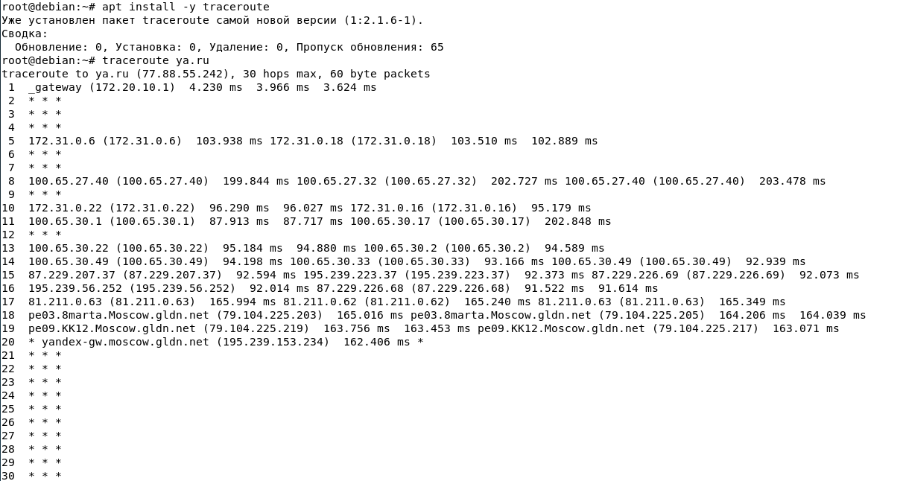
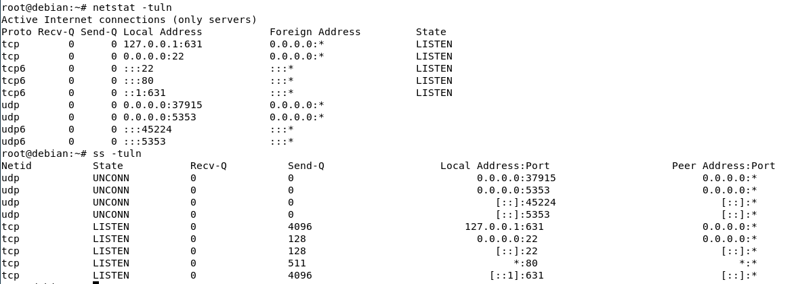

# Лабораторная работа № 3. Управление пакетами, системными сервисами и настройка сети

**Студент:** Гуркина В.   
**Группа:** ИС-25

## Цель работы

Настроить репозитории и установить пакеты, научиться управлять сервисами через `systemctl` и `cron`, настроить статический IP-адрес и изучить команды диагностики сети.

---

## Задание 1. Управление пакетами

### Настройка sources.list

В файл `/etc/apt/sources.list` внесены официальные репозитории Debian:

    deb http://deb.debian.org/debian trixie main contrib non-free non-free-firmware
    deb http://deb.debian.org/debian trixie-updates main contrib non-free non-free-firmware
    deb http://security.debian.org/debian-security trixie-security main contrib non-free non-free-firmware

    apt update

Списки пакетов загружены успешно.

### Установка пакетов

    apt install -y vim curl net-tools apache2

### Скрипт установки пакетов

    #!/bin/bash
    apt update
    apt install -y vim curl net-tools apache2

Скрипт выполняет обновление списков пакетов и устанавливает все необходимые пакеты.

---

## Задание 2. Работа с системными сервисами

    systemctl enable apache2 ssh       # включить автозапуск
    systemctl is-enabled apache2 ssh   # проверить автозапуск
    systemctl stop apache2             # остановить
    systemctl start apache2            # запустить
    systemctl enable --now apache2     # включить автозапуск и запустить
    systemctl status apache2           # статус

### Перезапуск Apache через cron

    crontab -e

Добавлена строка — перезапуск Apache каждый день в 2:00:

    0 2 * * * /usr/sbin/service apache2 restart

Поля: минута, час, день месяца, месяц, день недели. Проверка:

    crontab -l

---

## Задание 3. Конфигурация сети

### Настройка статического IP

В файле `/etc/network/interfaces` задан статический адрес:

    auto enp0s8
    iface enp0s8 inet static
        address 192.168.56.100/24
        gateway 192.168.56.1

`address` — IP-адрес, `gateway` — шлюз.

### Проверка

    ip a
    ping -c 4 ya.ru

Интернет работает, пакеты доставлены (0% потерь).

---

## Задание 4. Диагностика сетевых проблем

| Команда      | Что делает                                            | Пример               |
| :---         | :---                                                  | :---                 |
| `traceroute` | показывает путь пакета до сервера                     | `traceroute ya.ru`   |
| `netstat`    | показывает открытые порты и маршруты (старая команда) | `netstat -tuln`      |
| `ss`         | то же, что netstat, но новее и быстрее                | `ss -tuln`           |

### traceroute

    traceroute ya.ru

Первый узел — шлюз, далее видны промежуточные узлы.

### netstat и ss

    netstat -tuln   # открытые порты
    ss -tuln        # более современная команда

Порт 22 слушает `sshd` (SSH), порт 80 — `apache2`.

---

## Вывод

В ходе лабораторной работы были настроены репозитории и установлены пакеты (`vim`, `curl`, `net-tools`, `apache2`). Был написан bash-скрипт для автоматизации установки. Настроен автозапуск Apache и SSH, а также ежедневный перезапуск Apache через `cron`. Изучены принципы настройки статического IP-адреса и команды диагностики сети (`traceroute`, `netstat`, `ss`). Все задания выполнены в полном объеме.
